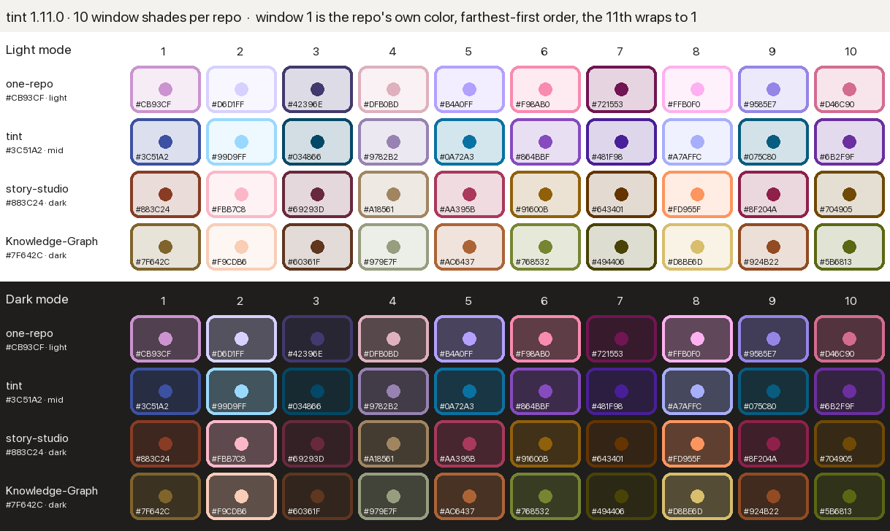

# How it works

## Two parts

| Part | Where it runs | What it does |
|---|---|---|
| **The mod** (`hooks/register.tsx`) | inside Claude Code, in every session | repository identity, window numbers, titles, terminal strip, `/mod_tint` commands |
| **The desktop tint** (`desktop/tint.js`) | inside the Claude desktop app's page, after you paste it | everything you see around the conversation: rings, tints, sidebar, loading dots |

Why two parts: a mod can draw inside the conversation, but it is sealed off from the app's page around it (no access to the page, by design). The desktop app also has no setting for user styles, refuses to start with debugging switches, and its code is sealed (Electron's asar integrity check). So the whole-app part is a small script that you save once as a DevTools snippet and run after each app start. `/mod_tint css` copies it, with your saved colors filled in.

## Identity

- **Emoji:** the first window of a new repository asks Claude Haiku once for an emoji that fits the repository. It is saved in `~/.claude/window-tint/repos.json` and never asked again. `/mod_tint icon 🧪` changes it. `/mod_tint repick` hands the choice to Claude in the window: it looks at what the repository is for, offers 3 emoji with AskUserQuestion, and applies the one you pick through tint's own tool (`mcp__tint__set`). The look before each change is kept, so `/mod_tint undo` goes back.
- **Color:** measured from the emoji as macOS draws it, by `helpers/emoji-color.swift` (compiled on first use into `~/.claude/window-tint/`). If the emoji is dull or grey, Claude's suggested color is kept. `/mod_tint color #hex` sets one by hand.
- **Number:** windows of the same repository agree on numbers through small files in `~/.claude/window-tint/windows/`. A window writes its claim at once and checks again; when two claim the same number at the same moment, the earlier claim keeps it (then the lower session id), and the 30-second heartbeat checks once more. Records not seen for a day are deleted. The number shows in the terminal strip and the desktop window's shade (its ring and background tint), never in the title: a title lasts, a number is only the window's slot while it is open.
- **Shades:** window 1 is the repository's own color. Windows 2 to 10 each move it one step in OKLCH (perceived lightness, chroma and hue): a lightness move as a share of the room left, a hue turn of at most 35 degrees and a chroma factor (`SHADES`, the same table in `hooks/register.tsx` and `desktop/tint.js`; a test holds the mod to colors worked out by running the desktop script's function). Lightness stays between 0.38 and 0.88, so no shade disappears on a white or a dark background; a color lighter than 0.81 or darker than 0.45 steps from that end, so its shades stay apart too (window 1 keeps its own color). A color outside sRGB loses chroma until it fits. The steps go farthest first: window 2 takes the shade most different from window 1, window 3 the one most different from both, and so on, worst case over 16 saved repository colors, so the first few windows (the ones usually open) differ most; a test holds that order. The 11th window wraps to the first.

  
- **Saving:** `repos.json` is written whole (a temporary file, then renamed over it). A `repos.json` that is there but cannot be read is never written over: the change is refused and says so, since a save would keep one repository and lose the rest.

## The frame around your messages

`/mod_tint frame on` draws a border in the window's color around your own messages; it is off at first. The border is a `UserMessage` drawing hook, and a plugin that hooks a component has every instance of it drawn through plugins. In Claude desktop 2.42304 each message then sits in a mod's box that the page draws again on every session-wide redraw, and the bubble fades out and back in. So the hook exists only while some repository has its frame on: `frame` is a plugin option (`userConfig`), kept in step with `repos.json` by the mod (`/mod_tint frame on` and `off`, tint's tool, and each session start). A change to an option reloads the plugin, which then registers the hook or leaves it out. With the frame off in every repository, tint draws nothing around messages and the app draws them itself. The option is one switch for all windows: while any repository has its frame on, every window's messages are drawn through tint (those with the frame off get no border). Its `/config` row is hidden, since `repos.json` decides and a change there would be undone at the next start; if this install names the row differently, the mod finds tint's own `.frame` row, and says so when the change is refused.

## Titles

A title is **Project · topic** (`Shop · Login bug`): the project in a word or two, then the main thread in 2 to 4 words, with no repository emoji, status words, dates or window number. The repository's emoji shows once, on its project heading in the desktop sidebar (the desktop tint puts it there), and in each window's terminal strip and live label. Since 1.12.0 threads under that heading no longer repeat it. A thread from another folder nested under that heading (a work room another session started) gets its own folder's emoji in front, drawn by the desktop tint, never written in the title (see [Thread colors](#the-desktop-tint)). The title's words never pick an emoji: tint 1.13.0 did, and 1.13.1 drops those emoji again.

```
🔮 one-repo
│  BAM UI · App design direction        one-repo's soft purple, no emoji
│  └ 📚 BAM UI · Screen audit           runs in bam-ui: its emoji, BAM green
│  EPT · Match Room refresh             one-repo's soft purple, no emoji
│  └ 💬 CM pricing · Kuba numbers       runs in one-repo: soft purple
🤖 AZKA-BOT
│  Chat session                         AZKA's soft teal
```

- **Role marks are kept.** The session that starts another one names it at birth: 💬 for a side chat, 🔧 for a helper. Tint cannot tell which session started which, so it keeps a title that starts with one. 💬 and 🔧 are never a repository's emoji.
- **A repository's emoji is dropped:** any emoji a repository in `repos.json` has or had (`icon`, `previous`, `pastIcons`, kept through `/mod_tint reset`), this repository's or another's, so a work room named with its project's emoji loses it too. A color square (shown until an emoji is picked) is dropped as well.
- **Any other emoji is the title's own** and stays, a flag or a skin tone included (`🇩🇪 Berlin · Launch`).
- **The form before 1.9.0** (`🧪1️⃣ Topic`, `🧪12 Topic`) loses its emoji and number. Two plain digits count only after a repository's emoji, so `🔥20 recap` stays as it is.
- **In the terminal** the mod sets the title itself, only when it changes something (a repository's emoji dropped, or the window name), and never to the bare folder name. **On the desktop** it never sets the title: the app now puts a hook's title over the one it made, so a short hidden note asks Claude to rename through the app's own tool: at your 2nd prompt, then every 5th, and once on any prompt (a parent session's message included) when the title still starts with a repository's emoji. Claude renames only when the title lacks the shape or the main topic changed. `/mod_tint titles off` stops it. With the tint hidden the note is the same, and the terminal title is left as it is.

## The desktop tint

What it looks for in the app's page (measured on Claude desktop 2.26454, October 2026):

| Part | How it is found |
|---|---|
| A window | `.epitaxy-chat-panel` |
| The session it shows | `[data-session-id]` inside the window |
| Its sidebar row | `[data-row-key="code:<session id>"]`; the highlight is the row's `.group` box (a thread nested under another has none: its label's nearest rounded box) |
| The message box | `[data-cds="ChatComposer"]`, its text input `.bg-surface-3` |
| Loading dots / Claude's mark | `[data-cds="WorkingMark"]` / `svg[data-cds="Spark"]` |
| Colors | the app's `--cds-surface-*` and `--cds-clay` variables |
| Which repository a thread is under | the sidebar: a repo heading is `[data-row-key^="label:project-"]`, in the same `group/section` box as its threads |

Where a repository's color comes from:

1. **Live colors:** while `repos.json` has a color or emoji the saved snippet does not, or `rooms.json` a session it has no folder for, the mod draws a 1-pixel picture (an `Svg`) in whatever band shows above each desktop window's prompt: the reminder, an update, or, when nothing else is on, a short **New colors** offer. Its label is `tint-colors {"repos": {name: [color, emoji]}, "rooms": {id: repo}, "window": [repo, number], "at": ms, "band": "colors"}`: every repository's chosen look from `repos.json`, the desktop sessions the saved snippet has no folder for yet (see Thread colors), the window's own repository, and when that window's copy of the mod last read a change in the colors (where labels disagree, the newest wins). The window number in it is not used: the windows' own agreement (1.9.1) gives every window its shade, labelled or not. `"band"` is there only on the New colors offer when it is alone in the band. The app draws each mod's tree inside an open shadow root on a `[data-plugin-drawn]` box, and the script looks there on each repaint, so a color chosen later shows at once with no reinstall. `"band": "colors"` means the band holds nothing else, so the script hides it: the colors already show. One exception: when a work room from another folder is among the rooms to save (`"fresh"`: those not put off with **Later**), the band stays, so its folder can be saved for after the next app start. Rooms alone bring the offer only after **✅ Done** in this app start, since only the running script can tell a work room from another folder. The band of a window that just opened can show for about a second before the script hides it. It marks the window and a style rule hides the band's box, so a box the app replaces stays hidden. When the script is not running, the band stays and offers to save the colors into the snippet. Until tint 1.9.1 the picture sat in the footer (`SessionMode`), but Claude desktop 2.42304 keeps only text and buttons there.
2. **Saved colors** filled in when the snippet was saved (from `repos.json`), when the repository is there.
3. Otherwise **the emoji its thread's title starts with** (`🗂️ …`), drawn on a canvas and measured the same way the mod measures it. Titles from tint 1.12.0 on carry no repository emoji, so this helps only an older title. A grey emoji gets a steady color made from the emoji itself. A color square, 💬 or 🔧 gives no color. Colors are never learned from other threads in the sidebar: a title's emoji may be a role or another project's.

So a new repository needs no new copy of the script.

## Installing the desktop tint

The app keeps DevTools snippets in its settings file, `~/Library/Application Support/Claude/Preferences`, under `electron → devtools → preferences → script-snippets`. It rewrites that file while it runs, so a change made then would be lost.

`/mod_tint desktop` only says what will happen. `/mod_tint desktop go` writes the script (with saved colors) to `~/.claude/window-tint/desktop-snippet.js` and a small `install-desktop.command` file next to it, and opens that file in Terminal, where it runs `helpers/desktop-snippet.py` in plain sight (`/mod_tint desktop line` copies the same line instead):

1. It quits the app (the app's own Quit) and waits for it to close.
2. It copies the settings file to `~/.claude/window-tint/Preferences.backup`.
3. It saves the snippet `tint` (replacing an older one) and sets DevTools to open on Sources → Snippets. Nothing else changes. It checks the new file reads back as valid JSON before swapping it in.
4. If Developer Mode is off, it turns it on in `developer_settings.json` (`allowDevTools: true`), the same file and value the app's Help → Troubleshooting → Enable Developer Mode… writes.
5. It opens the app again and exits. Nothing keeps running.

At the start of a desktop session, on each heartbeat and right after a color or emoji changes, the mod compares the saved snippet with its own script and says when an update is ready. Repo colors and rooms are compared on their own: colors or rooms the snippet lacks bring the **New colors** offer and the live picture described above. **Later** puts the offer off for that set of colors and rooms until the app starts again; the picture still rides in any other band. With nothing left to save there is no picture, and the script goes back to the saved colors. It reads the app's settings file again only when its modification time changes, and asks `ps` for the app's start time once per session start and then every 10 minutes.

The band above the prompt stands still: a fixed color strip, no clock, and for the reminder "Closes by itself in a minute". A clock tick each second only reads state, and writes when a band starts or ends, so the band is drawn again only when what it says changes.

How it draws:

- **The window you are in** is your last choice: a click or the keyboard inside a window, or a click (one or two) on a sidebar thread, which picks the window showing that thread once the app shows it. Only that window gets the strong ring and the filled sidebar highlight; other open threads get a thin bar. A click that picks no window (a repo heading, a thread the app does not open), a right click, a thread's own buttons (its … menu) and the keyboard coming back to the same place (when you switch back to the app) change nothing. In a window without a tint (no session or no color yet) no window is the focused one. When the script starts, or once the chosen window closes, the window holding the keyboard counts. Each repaint first takes the last repaint's fills and bars off, so a thread you left never keeps them (a nested thread's box can be its whole row, which stays in use for the hover color).
- **Tints** set the app's own color variables inside each window, so the app keeps drawing everything itself.
- **The ring** is a layer on the slot around the window, a few pixels outside the window's edge. The script never changes a box's size (an older width limit to even the gaps could keep a window stuck narrow), so the right gap can be a little smaller. Each repaint removes rings left on boxes that are no longer a window's slot.
- **Loading dots** are drawn in a fixed orange that ignores color settings, so a CSS filter turns that orange into the window's color.
- **Titles** are left as they are, in the sidebar and in each window's top bar, so a role mark (💬, 🔧) stays in view. The repository's emoji goes in front of its name on the sidebar heading, once for all its threads.
- **Thread colors** come from the folder a thread runs in, never from its title's words. A thread under its own folder's heading takes a soft shade of that repository's color and no emoji. A thread from another folder, nested under the session that started it, takes that folder's soft color and its emoji in front (an `::before` the script adds on the box that holds the title's text, so it sits on the title's line and a long title is still cut with "…"; the title is not changed); a title that already starts with an emoji, 💬 or 🔧 gets none in front. The sidebar tells the script only a nested thread's parent heading, and keys each row by the desktop app's own id for the session, which is not the id the mod has. The app names that id to the session in one variable, `CLAUDE_CODE_HOST_SESSION_ID`, the only one the mod reads: each desktop session notes `{id: repo}` in `~/.claude/window-tint/rooms.json` at its start and again on each heartbeat (should two windows write at the same moment), the newest 400 kept. The snippet is saved with those (`ROOMS`, for each repository with a color), and sessions started since ride in the live label's `rooms`, which the script keeps until it stops. A session with no noted folder (a terminal, or should the app stop naming the id) is known once its window has been open while the script runs (the window's live label or header chip). Until then it is taken for its heading's folder: the page cannot tell a nested row from a top-level one (in the app both have a `.group` box), so every row takes its session's known folder, else its heading's. With no color from either, a 💬 or 🔧 thread takes the color of the thread above it. Two names with one look (a repository and a folder name it is known by, or two repositories with the same emoji and color) count as one folder. The selected thread (the window you are in) keeps its fill and the app's text, and still gets the emoji; a thread open in another window keeps its thin bar and also gets the soft color. The shade has less chroma than the folder's color, at a lightness for the mode, and is moved away from the background until its contrast is at least 4.5 (WCAG AA for text) against the sidebar's surfaces and the row's own hover tint, in light and dark mode. A nested thread from another folder hovers in that folder's color.
- **Redraws** happen when a window, session, sidebar row or live label comes, goes or changes (the app replaces the boxes mods draw in many times a second and redraws inside them; those only lead to a look at the labels, at most every 0.25 s. A reading taken while a band box is still empty (just put in by the app) is skipped, the looks come at slightly random moments, and a new reading counts once it is the same on 2 looks in a row, or 4 when labels only went away; only a counted change repaints, and a repaint uses the last counted reading), when anything outside the windows changes, when you click into another window or on a sidebar thread, and when a window changes size. The conversation inside a window (Claude's streamed text, tool output, what you type) changes many times a second and never causes a redraw. Each redraw measures every window first, then paints.

Running the script again removes everything it added and paints from scratch, even after a failed first paint. Reloading the app removes it.

## Privacy

The desktop script reads only the open page, sends nothing, stores nothing and changes no file. The mod reads and writes only `~/.claude/window-tint/`, plus one small Claude Haiku call per new repository. Of the environment it reads only `HOME` and, in the desktop app, `CLAUDE_CODE_HOST_SESSION_ID`.
